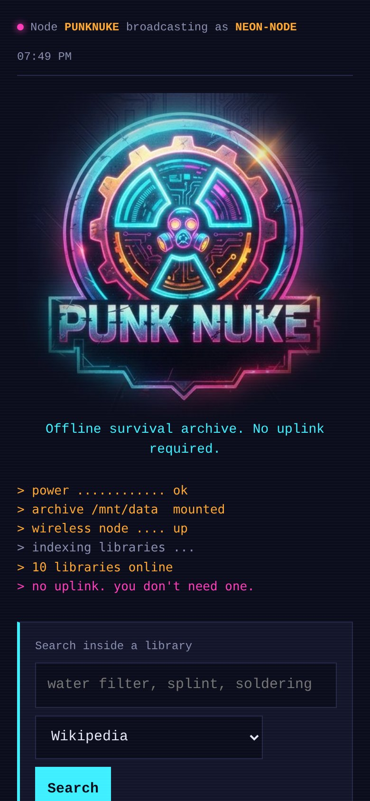
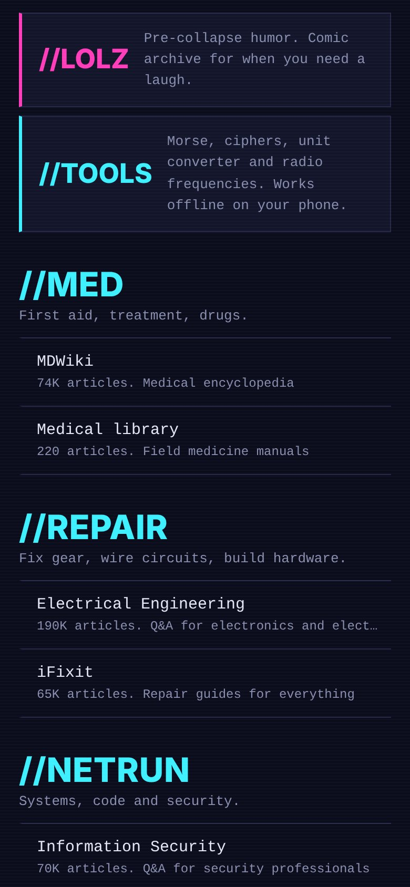
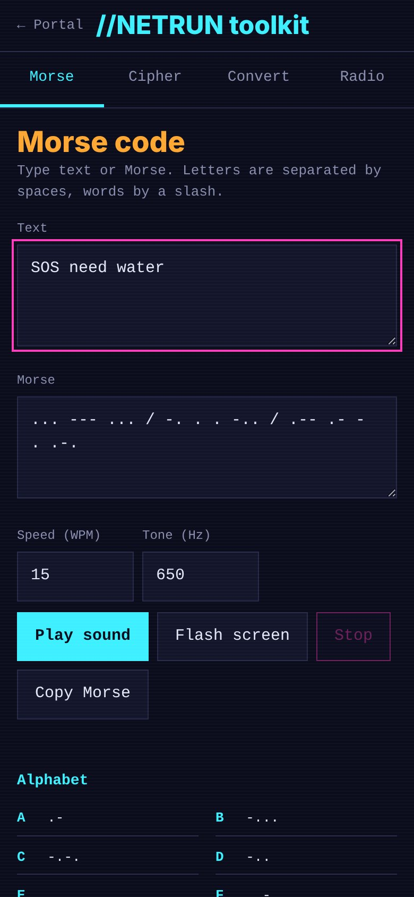
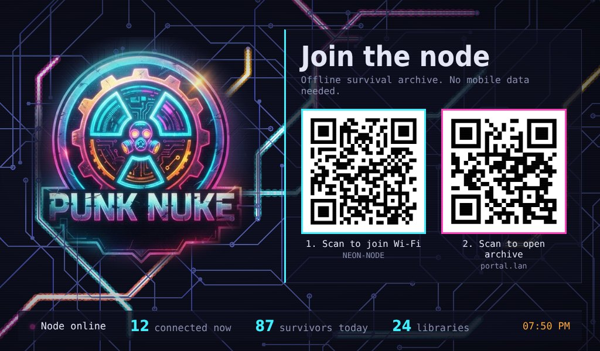
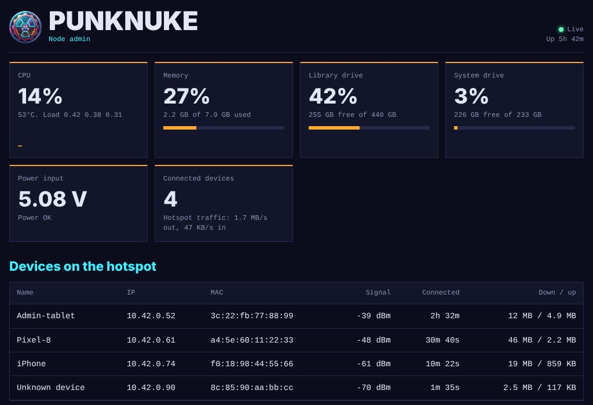
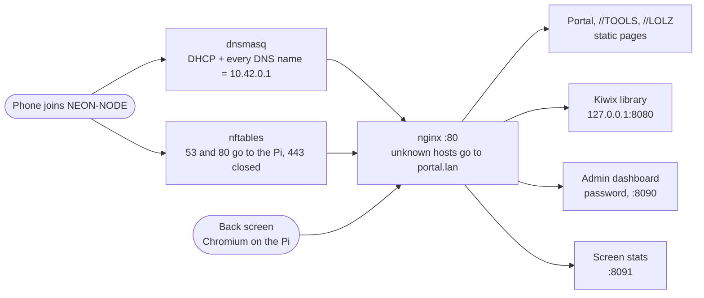

<p align="center">
  
</p>

<h1 align="center">PunkNuke</h1>

<p align="center"><b>A wearable offline survival-knowledge node for a cyberpunk cosplay.</b><br>
A Raspberry Pi 5 on a plate carrier that broadcasts its own Wi-Fi, pops up a captive portal on every phone that joins, and serves an offline library of medicine, repair, tech and survival knowledge. No internet, no mobile data needed.</p>

<p align="center"><a href="https://cainedk.github.io/punknuke/">Project page</a> · <a href="https://cainedk.github.io/punknuke/demo/tools/">Live //TOOLS demo</a> · <a href="#install">Install</a></p>

---

## What it does

- **Open hotspot `NEON-NODE`.** Anyone nearby can join; no password, no internet.
- **Captive portal.** Phones show the PunkNuke page automatically when they connect, like hotel Wi-Fi. Any plain web address someone types also lands on the portal.
- **Offline library** served by [Kiwix](https://kiwix.org): Wikipedia, MDWiki, iFixit, survival manuals, Stack Exchange sites and more, sorted into **//MED**, **//REPAIR**, **//NETRUN**, **//SURVIVE** and **//ARCHIVE**, with search.
- **//TOOLS.** A netrunner toolkit that runs on the visitor's phone: Morse code (with sound and screen flashing), cipher encoder/decoder, unit converter, antenna lengths, Ohm's law, and a radio frequency reference.
- **//LOLZ.** An offline comic archive, because survivors need to laugh too.
- **Back screen.** A 7" display on the outside of the box shows the logo, QR codes to join and open the portal, and live stats over an animated circuit background. Display only, so nobody pokes the wearer in the back.
- **Admin dashboard.** A password-protected page for a tablet: CPU, temperature, memory, both drives, input voltage, connected devices, service status, and reboot/shutdown buttons.

## Screenshots

| Portal | Library sections | //TOOLS |
| --- | --- | --- |
|  |  |  |

**Back screen (7" HDMI display)**



**Admin dashboard (tablet)**



*Screenshots use sample data.*

## How it works



Every DNS lookup from the hotspot answers with the Pi's address, and every plain-HTTP request is redirected to `http://portal.lan/`. Phones see that redirect when they check for internet access and open the portal automatically. HTTPS sites can't be redirected without certificate errors, so they fail instantly instead; the automatic portal popup covers this.

## Hardware

| Part | Original build |
| --- | --- |
| Computer | Raspberry Pi 5 (the official Active Cooler is recommended inside a closed box) |
| System drive | 256 GB NVMe on an M.2 HAT, Raspberry Pi OS Lite 64-bit (Bookworm) |
| Library drive | 480 GB SATA SSD on a USB 3 adapter (anything 256 GB or larger works) |
| Wi-Fi | The Pi's onboard Wi-Fi runs the hotspot |
| Back screen | 7" HDMI display with USB touch (optional) |
| Power | 20,000 mAh USB-C powerbanks in MOLLE pouches; a separate bank for the screen |
| Admin | Any tablet or phone joined to the hotspot |

Expect roughly 9-15 W for the Pi, drives and Wi-Fi, before the screen. A 20,000 mAh bank (about 74 Wh) gives around 4-6 hours.

**Power tip:** the Pi 5 limits USB devices to 600 mA in total unless it detects a 5 A supply. A bus-powered SSD writing at full speed can exceed that and drop off. A powered USB hub, or a SATA adapter with its own power input, fixes it.

## Install

These steps assume a fresh **Raspberry Pi OS Lite (64-bit)** with SSH, Ethernet internet on `eth0`, and the hotspot on `wlan0`.

### 1. Prepare the library drive

Format the drive as ext4 with the label `data` and mount it at `/mnt/data`. **Check the device name with `lsblk` first; this erases the drive.**

```bash
sudo parted /dev/sda --script mklabel gpt mkpart data ext4 0% 100%
sudo mkfs.ext4 -L data -m 0 /dev/sda1
sudo mkdir -p /mnt/data
echo 'LABEL=data /mnt/data ext4 defaults,noatime,nofail 0 2' | sudo tee -a /etc/fstab
sudo systemctl daemon-reload && sudo mount -a
sudo chown -R "$USER:$USER" /mnt/data
```

### 2. Get the code and turn on Wi-Fi

```bash
sudo apt update && sudo apt install -y git
git clone https://github.com/cainedk/punknuke.git
cd punknuke
sudo rfkill unblock wifi && sudo nmcli radio wifi on
```

### 3. Run the setup scripts, in this order

```bash
sudo bash scripts/setup-portal.sh wlan0 NEON-NODE   # hotspot, DHCP/DNS, web server, Kiwix
sudo bash scripts/setup-redirect.sh wlan0           # firewall redirect rules
sudo bash scripts/install-web.sh                    # portal page, logo, icons, //TOOLS
sudo bash scripts/setup-admin.sh                    # admin dashboard; asks for a username and password
sudo bash scripts/setup-kiosk.sh                    # optional: back screen on the HDMI display
sudo bash scripts/setup-comics.sh                   # optional: //LOLZ comic archive
```

`setup-portal.sh` sets the Wi-Fi country to `DK`. Edit `COUNTRY=` at the top of the script first if you're elsewhere.

`setup-portal.sh` writes a basic web server config. `setup-admin.sh` and `setup-kiosk.sh` replace it with the full one, so if you ever rerun `setup-portal.sh`, rerun `setup-admin.sh` afterwards.

### 4. Download the library

```bash
nohup bash scripts/download-content.sh > ~/download.log 2>&1 &
tail -f ~/download.log
```

It runs in the background and keeps going after you log out. Each library appears on the portal as soon as it finishes. Full English Wikipedia alone is about 118 GB and takes hours; everything else together is much smaller.

### 5. Test

Connect a phone to **NEON-NODE**. The portal should pop up within a few seconds. From your home network, the box is at `http://<hostname>.local`, and the admin page at `http://portal.lan/admin/` (on the hotspot) or `http://<hostname>.local/admin/`.

Everything starts automatically at boot. Always shut down with `sudo poweroff` (or the admin page button) before cutting power.

## Adding content

**More Kiwix libraries.** `add-zim.sh` finds the newest English edition by keyword, downloads it, and adds it to the downloader's list:

```bash
bash scripts/add-zim.sh factbook          # CIA World Factbook
bash scripts/add-zim.sh wikem other zimit # search specific Kiwix folders
```

Browse [library.kiwix.org](https://library.kiwix.org) for ideas. New libraries are sorted into portal sections by filename; anything unrecognised goes under //ARCHIVE. Edit `CATS` in `web/portal/index.html` to change that.

**More comics or images.** Put a folder of images in `/mnt/data/comics/<name>/` (letters, digits, `-` or `_`), optionally add a `title.txt`, then run:

```bash
python3 /opt/punknuke/comics-index.py
```

## Useful commands

| Task | Command |
| --- | --- |
| Check all services | `systemctl is-active dnsmasq nginx kiwix portal-nft punknuke-stats punknuke-public punknuke-kiosk` |
| Hotspot off / on | `sudo nmcli con down portal` / `sudo nmcli con up portal` |
| Restart web server / library | `sudo systemctl restart nginx` / `sudo systemctl restart kiwix` |
| Stop downloads | `pkill -f download-content.sh; pkill aria2c` |
| Drive space | `df -h /mnt/data` |
| Drive errors | `sudo dmesg \| grep -iE 'reset\|offline\|i/o error' \| tail -5` |
| Power state | `vcgencmd get_throttled` (`0x0` is good) |
| Back screen logs | `journalctl -u punknuke-kiosk -n 30` |

## Troubleshooting

Lessons from the original build:

| Symptom | Cause | Fix |
| --- | --- | --- |
| `wlan0` shows "unavailable" | Wi-Fi is soft-blocked on a fresh install | `sudo rfkill unblock wifi && sudo nmcli radio wifi on` |
| Download hangs and can't be killed, even with `kill -9` | The USB-SATA adapter's UAS driver hung | Add `usb-storage.quirks=VID:PID:u` to `/boot/firmware/cmdline.txt` (find VID:PID with `lsusb`), reboot |
| SSD drops off USB under heavy writes, filesystem goes read-only | Not enough USB power for the drive, or a weak adapter | Powered hub or self-powered adapter; the downloader is already speed-limited to 15 MB/s |
| Download refuses to resume, mentions a `.meta4` file | Leftover mirror list from an interrupted run | Already handled by the scripts; otherwise delete the `.meta4` file in `/mnt/data/zim-incoming` |
| Download stops when SSH closes | The run is tied to the session | Start it with `nohup … &` as shown above |
| Search says "No such book" | Old portal page | Run `scripts/install-web.sh` again |
| Portal looks old on a phone | Phone cached the page | Close the tab or reconnect to the Wi-Fi |

## Repository layout

```
scripts/
  setup-portal.sh       hotspot, dnsmasq, nginx, Kiwix services
  setup-redirect.sh     nftables rules that catch DNS, HTTP and HTTPS
  install-web.sh        copies web/portal into /var/www/portal
  setup-admin.sh        admin dashboard, stats API, full nginx config
  setup-kiosk.sh        back-screen display (cage + Chromium) and its stats API
  setup-comics.sh       //LOLZ comic reader and archive download
  download-content.sh   downloads and updates the Kiwix library
  add-zim.sh            adds one more Kiwix library by keyword
web/portal/
  index.html            visitor portal
  tools/index.html      //TOOLS netrunner toolkit
  logo.jpg, icons       branding
docs/                   GitHub Pages project site
```

The admin, back-screen and comic-reader pages are embedded in their setup scripts, so each script is self-contained.

**Project page:** the `docs/` folder is a ready-made GitHub Pages site, including a live demo of //TOOLS. To publish it, open the repository's **Settings → Pages**, choose **Deploy from a branch**, then branch `main` and folder `/docs`.

## Security and safety notes

- The hotspot is **open and unencrypted** by design. Don't use it for anything private.
- The admin password travels over plain HTTP on that open network. Fine for a cosplay prop; don't reuse an important password.
- The radio reference is for information. Transmitting on most frequencies needs a licence; check your local rules.
- The offline medical content is reference material, not a substitute for professional help.

## Third-party content

Not included in this repository; the scripts download it:

- [Kiwix](https://kiwix.org) and the ZIM libraries it serves. Wikipedia and Stack Exchange content is CC BY-SA; check each library's own licence.
- *User Friendly* comics © J. D. Frazer (Illiad), downloaded from the [Internet Archive](https://archive.org/details/user-friendly-comic) for personal, non-commercial use. Don't redistribute them.
- nginx, dnsmasq, NetworkManager, nftables, cage and Chromium, under their own licences.

## License

The code in this repository is released under the [MIT License](LICENSE). The PunkNuke name and logo belong to the author and are not covered by the MIT License.
